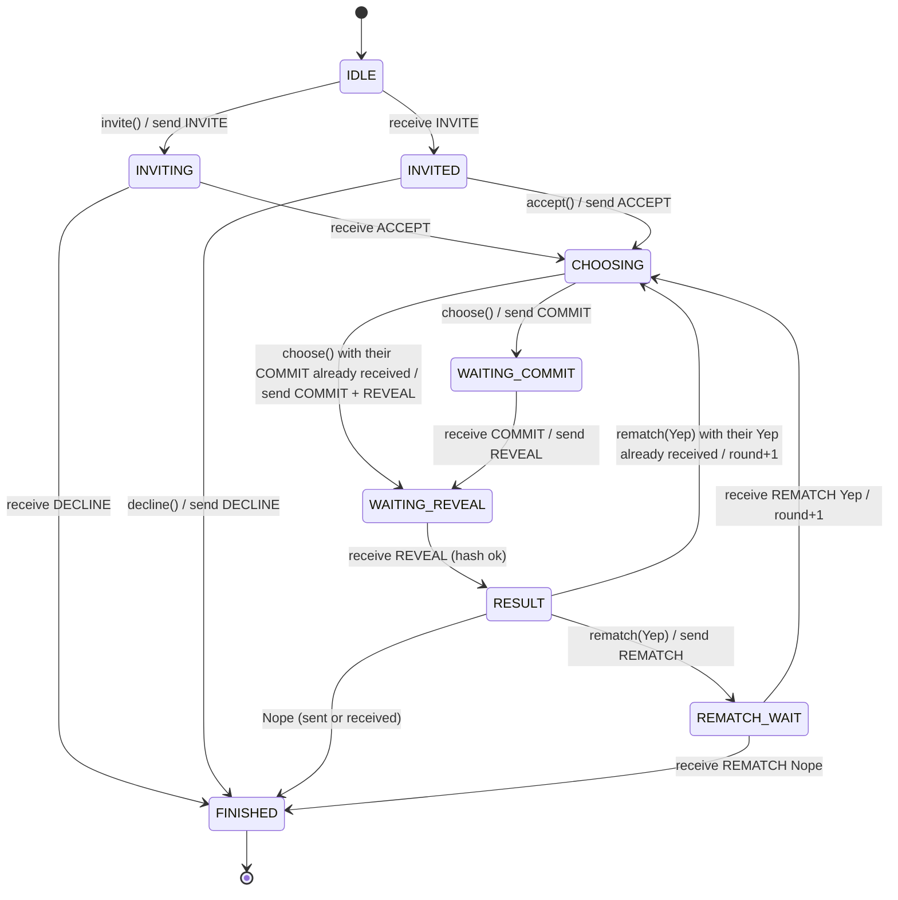
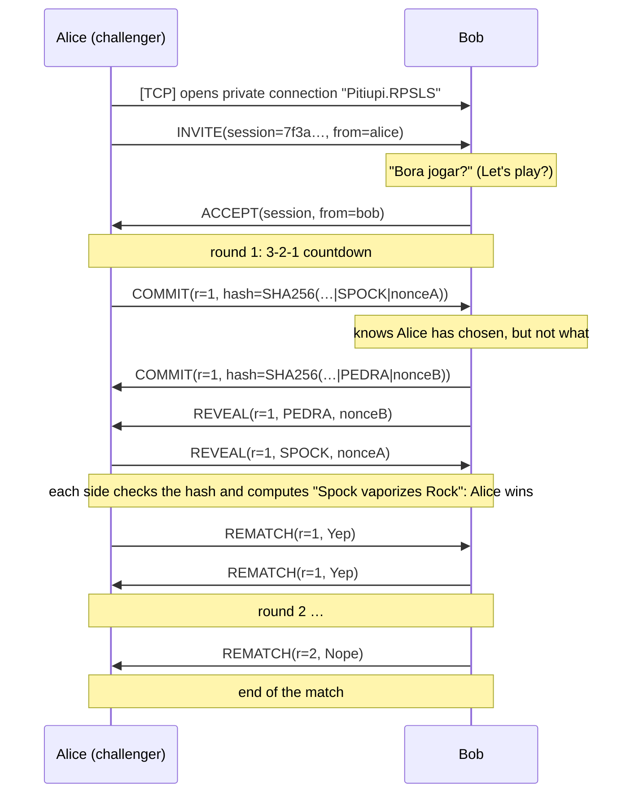

# The RPSLS/1.0 Protocol

🇧🇷 *Versão em português: [PROTOCOLO.md](PROTOCOLO.md)*

Application protocol of the **Rock, Paper, Scissors, Lizard, Spock** plugin for Pitiupi.
Two players, **unicast** communication over a Pitiupi **private TCP connection**.

> Naming: move names travel in Portuguese, as they appear on screen —
> `PEDRA` = Rock, `PAPEL` = Paper, `TESOURA` = Scissors, `LAGARTO` = Lizard, `SPOCK` = Spock.

## 1. Stack and transport

```
+-----------------------------------------------+
| RPSLS/1.0  (INVITE, COMMIT, REVEAL, ...)      |  application (this document)
+-----------------------------------------------+
| Pitiupi: private connection + framing         |  [length: 4-byte int][serialized Java object]
+-----------------------------------------------+
| TCP  (port chosen at login, e.g. 8000)        |  reliable, ordered transport
+-----------------------------------------------+
| IP (local network)                            |
+-----------------------------------------------+
```

**Why private TCP (unicast) and not UDP/multicast?**

- A match involves only two players, so multicast brings no advantage.
- The protocol depends on **ordering** and **guaranteed delivery**: a player's REVEAL may only arrive after their COMMIT, and losing a COMMIT would stall the round. TCP provides this for free; with UDP we would have to implement ACKs, retransmission and sequence numbers.
- Pitiupi's private connection delivers each message only to the plugin with identifier `Pitiupi.RPSLS` on the other side. It also reports when the connection drops (`onSocketClosed`), which is how the opponent leaving is detected.

The connection is opened by the challenger's plugin (`connectTcp(ip, "Pitiupi.RPSLS", "Pitiupi.RPSLS")`) and lasts for the whole match, rematches included.

## 2. Messages

Every message is an `RpslsMessage` object with the field `protocol = "RPSLS/1.0"`. Messages of another version are discarded.

| Type | Fields | Sent by | Meaning |
|---|---|---|---|
| `INVITE` | sessionId, senderName | challenger | "Let's play Rock, Paper, Scissors, Lizard, Spock?" |
| `ACCEPT` | sessionId, senderName | challenged player | "Let's go!" Round 1 starts. |
| `DECLINE` | sessionId, reason | challenged player | Invitation declined |
| `COMMIT` | sessionId, round, hash | both | "I have chosen". Carries only the hash of the move |
| `REVEAL` | sessionId, round, move, nonce | both | Opens the move after receiving the other's COMMIT |
| `REMATCH` | sessionId, round, accept | both | "Play again?" Yep (`true`) / Nope (`false`) |
| `BYE` | sessionId, reason | both | Termination (leaving, protocol error, cheating detected) |

- `sessionId`: UUID generated by the challenger. Identifies the match.
- `round`: round number (1, 2, 3...). Messages of another round are rejected.
- `move`: `PEDRA`, `SPOCK`, `PAPEL`, `LAGARTO` or `TESOURA`.
- `reason`: free text shown to the other player, therefore in Portuguese (e.g. `"agora não"` = "not now", `"tempo esgotado"` = "time is up").

## 3. A fair round: commit‑reveal

Without a central server, a player could wait for the other's move to arrive and only then pick the winning one. To prevent that, each round has two phases:

1. **COMMIT**: when clicking a move, the player sends only

   `hash = SHA-256( sessionId | round | MOVE | nonce )`

   The `nonce` is random (128 bits, `SecureRandom`). Without it, hashing the 5 possible moves would be enough to find out which one was chosen.
2. **REVEAL**: once a player **has sent their own COMMIT and received the opponent's**, they send `move` and `nonce`. The receiver recomputes the hash and compares it with the COMMIT received earlier.
   - If it matches, the round is valid.
   - If it does not, the opponent changed the move after committing: the game sends `BYE("erro de protocolo: REVEAL não confere...")` (protocol error: REVEAL does not match) and ends.

`sessionId` and `round` are part of the hash, so an old COMMIT cannot be reused in another round or match.

The **result is never transmitted**. Both sides have both moves and apply the same deterministic rule, so they reach the same result.

## 4. Rules

The moves are in circular order: `PEDRA(0) → SPOCK(1) → PAPEL(2) → LAGARTO(3) → TESOURA(4)`.

```
d = (mine - theirs + 5) % 5      0 → draw     1 or 2 → I win     3 or 4 → I lose
```

Each move beats the two before it in the cycle and loses to the two after it. This computation matches exactly the game's 10 relations:

| | | |
|---|---|---|
| Scissors **cuts** Paper | Paper **covers** Rock | Rock **crushes** Lizard |
| Lizard **poisons** Spock | Spock **smashes** Scissors | Scissors **decapitates** Lizard |
| Lizard **eats** Paper | Paper **disproves** Spock | Spock **vaporizes** Rock |
| Rock **crushes** Scissors | | |

(On screen they appear in Portuguese, e.g. "Spock vaporiza Pedra".)

## 5. State machine (each player)



In any state, the following lead to `FINISHED`:
- `BYE` received;
- local `quit()`, which sends `BYE`;
- the TCP connection dropping;
- a **protocol error**: a message not expected in the current state, from another session or round, or a REVEAL that does not match. In that case the game sends `BYE` with the reason.

The opponent's COMMIT may arrive while the local player is still choosing (`CHOOSING`). It is stored, and the REVEAL goes out as soon as the local player chooses.

## 6. Example match



## 7. Error handling

| Situation | Behavior |
|---|---|
| Invitation declined | `DECLINE(reason)`; the challenger sees the reason |
| Out-of-order message, or from another session/round | `BYE("erro de protocolo: …")` and end |
| REVEAL does not match COMMIT | `BYE("erro de protocolo: REVEAL não confere…")` and end, no result |
| Player closes the window | `BYE(reason)` |
| Connection drops | `onSocketClosed` → end ("Conexão com o adversário perdida" = connection with the opponent lost) |
| Bytes that are not an `RpslsMessage` / other version | discarded |
| Opponent does not answer | deadline expires → `BYE("tempo esgotado")` (see section 8) |
| Invitation arrives during another match | `DECLINE("jogador ocupado em outra partida")` (player busy) — one match at a time |

## 8. Deadlines (timeouts)

TCP guarantees delivery, but not that the other player **answers**: they may have gone for a coffee, or the process may have hung without closing the socket. Each state has a deadline (`game.Timeouts`). When it expires, `GameSession.onTimeout` applies the policy:

| State | Deadline | On expiry |
|---|---|---|
| `INVITING` (waiting for accept) | 30 s | `BYE("convite expirou")` (invitation expired) |
| `INVITED` (I did not answer) | 30 s | `DECLINE("tempo esgotado")` (time is up) |
| `CHOOSING` | 3 s countdown + 10 s | **random move**: the game never hangs and the player is told |
| `WAITING_COMMIT` | 23 s | `BYE("tempo esgotado")` |
| `WAITING_REVEAL` | 10 s | `BYE("tempo esgotado")` (REVEAL is automatic, should be immediate) |
| `RESULT` (I did not answer "Play again?") | 60 s | counts as **Nope** |
| `REMATCH_WAIT` | 70 s | `BYE("tempo esgotado")` |

The deadlines for waiting on the opponent are longer than the opponent's own deadlines, so the "right" side always resolves first. A late deadline notice (from a state or round already over) is ignored.

## 9. Integration with Pitiupi

- **Challenging:** the *Jogos → Desafiar para RPSLS* menu (Online panel) calls `connectTcp(ip, "Pitiupi.RPSLS", "Pitiupi.RPSLS")` and, once connected, sends `INVITE`.
- **Receiving:** Pitiupi calls `receiveBytes(connection, bytes)`. If the connection already has a match, the bytes go to it. If not and the message is an `INVITE`, a match is created on the invited side. Any other message is ignored.
- **Dropping:** `onSocketClosed(connection)` ends that connection's match.
- **Threads:** Pitiupi's network threads, the Swing thread and a deadline thread (`rpsls-timer`) all touch the session. That is why `GameSession`'s methods are `synchronized`, and the GUI is only updated through `SwingUtilities.invokeLater`.
- **Two APIs:** Pitiupi has two versions of its plugin API: the legacy `createPlugin(ConnectionManager, GuiManager)` on the `main` branch, and the facade `createPlugin(Pitiupi)` in the tutorial and on `update/mpChat`. `RpslsPlugin` implements both methods, and each one creates an adapter (`host.LegacyHost` / `host.FacadeHost`) for the `host.Host` interface. On the legacy core the facade method is never called and the `Pitiupi` class is never loaded, so a single `pitiupi.rpsls.jar` serves both versions. To also compile against `main`, which lacks the facade class, the project includes a compile‑only stub `src/pitiupi/plugin/Pitiupi.java`. It is excluded from the jar (`dist.archive.excludes`), and at runtime the core's class is always used.
- **Core bug in the private connection:** on `main` and `release/facade.v2.0.0`, `PluginManager.handleConnection` always returns `false`. `SocketTCP` therefore replies `RECEIVER_NOT_FOUND` and never starts reading the private connection, so no unicast plugin receives data. On load, the plugin probes the core: it creates an isolated `PluginManager` with a test plugin and calls `handleConnection` (`host.PrivateConnectionFix`). If the bug is present, the plugin reads the connection itself in a thread, using the core's own framing (`TcpConnection.receive()`), and discards the `RECEIVER_NOT_FOUND`. On a fixed core the workaround is not enabled. The fix in the core is one line: `return true;` in `handleConnection`.
- **Limitation:** the plugin API offers no way to close the `TcpConnection`. `BYE` ends the match at the application level, and the connection stays idle until Pitiupi's own timeout. A new challenge opens a new connection.

## 10. Where it lives in the code

| Class | Role |
|---|---|
| `game.Move`, `game.Rules`, `game.Outcome` | moves and rules |
| `game.Commitment` | SHA‑256 + nonce (commit‑reveal) |
| `game.GameSession` | state machine (including the deadline policy), no network and no GUI |
| `game.Timeouts` | deadline of each state |
| `net.Match` | binds the session to the `TcpConnection`, schedules deadlines, forwards notifications to the GUI |
| `net.RpslsMessage` | protocol PDU and (de)serialization |
| `gui.MatchWindow` | match window (invitation, countdown, moves, result, rematch) |
| `gui.ChallengeMenu` | "Desafiar para RPSLS" item in the Online panel menu |
| `gui.RpslsTopMenu` | Jogos → RPSLS: "Desafiar por IP..." and "Meus endereços IP" |
| `gui.MoveIcon`, `gui.Widgets`, `gui.Theme` | move icons (images in `gui/img/`), hand-painted components and colors |
| `plugin.RpslsPlugin` | Pitiupi integration: menus, private TCP connection, one match at a time |
| `host.Host`, `LegacyHost`, `FacadeHost` | adapters for Pitiupi's two plugin APIs |
| `host.PrivateConnectionFix` | detects and works around the private-connection bug |
| `test/…/RpslsTests` | 20 tests: rules, commit‑reveal, simulated matches and deadlines (`make test`) |
