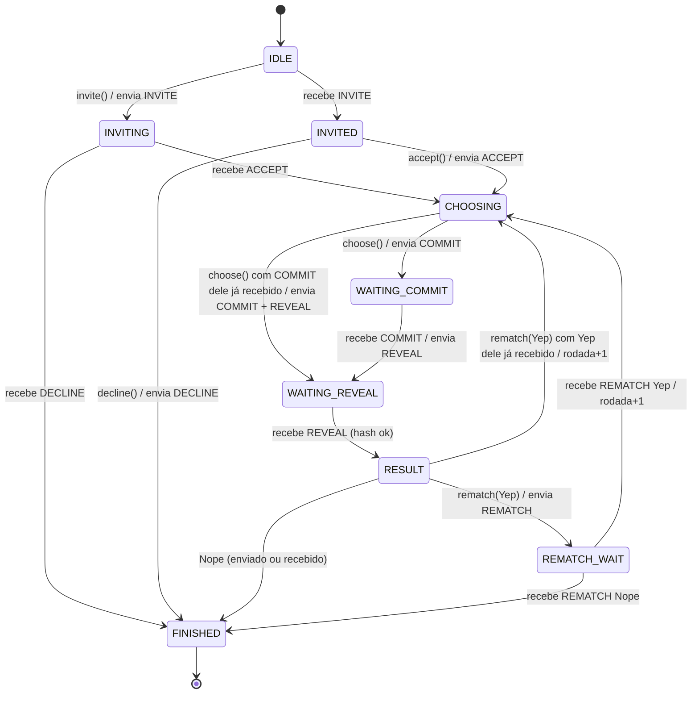
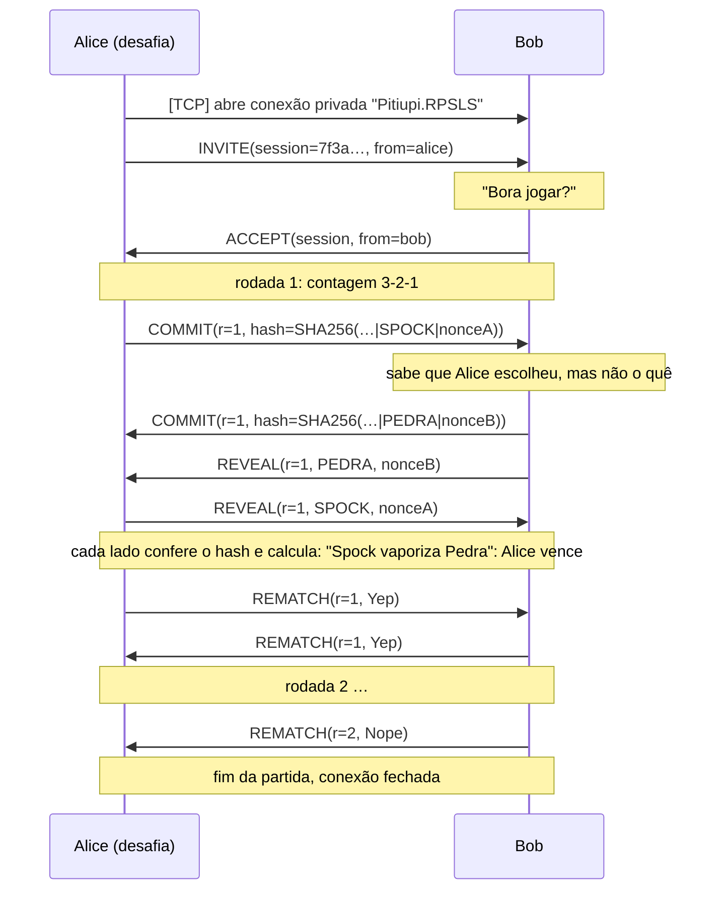

# Protocolo RPSLS/1.0

🇺🇸 *English version: [PROTOCOL.md](PROTOCOL.md)*

Protocolo de aplicação do plugin **Pedra, Papel, Tesoura, Lagarto, Spock** para o Pitiupi.
Dois jogadores, comunicação **unicast** sobre uma **conexão TCP privada** do Pitiupi.

## 1. Pilha e transporte

```
+-----------------------------------------------+
| RPSLS/1.0  (INVITE, COMMIT, REVEAL, ...)      |  aplicação (este documento)
+-----------------------------------------------+
| Pitiupi: conexão privada + enquadramento      |  [tamanho: int de 4 bytes][objeto Java serializado]
+-----------------------------------------------+
| TCP  (porta configurada no login, ex.: 8000)  |  transporte confiável e ordenado
+-----------------------------------------------+
| IP (rede local)                               |
+-----------------------------------------------+
```

**Por que TCP privado (unicast) e não UDP/multicast?**

- A partida envolve só dois jogadores, então multicast não traz vantagem.
- O protocolo depende de **ordem** e **entrega garantida**: o REVEAL de um jogador só pode chegar depois do COMMIT dele, e perder um COMMIT travaria a rodada. Com TCP isso vem de graça. Com UDP seria preciso implementar ACKs, retransmissão e numeração.
- A conexão privada do Pitiupi entrega cada mensagem só ao plugin de identificador `Pitiupi.RPSLS` do outro lado. Ela também avisa quando a conexão cai (`onSocketClosed`), o que serve para detectar a saída do adversário.

A conexão é aberta pelo plugin de quem desafia (`connectTcp(ip, "Pitiupi.RPSLS", "Pitiupi.RPSLS")`) e dura a partida inteira, incluindo as revanches.

## 2. Mensagens

Toda mensagem é um objeto `RpslsMessage` com o campo `protocol = "RPSLS/1.0"`. Mensagens de outra versão são descartadas.

| Tipo | Campos | Quem envia | Significado |
|---|---|---|---|
| `INVITE` | sessionId, senderName | quem desafia | "E aí, bora jogar Pedra, Papel, Tesoura, Lagarto, Spock?" |
| `ACCEPT` | sessionId, senderName | quem foi desafiado | "Bora!" A rodada 1 começa. |
| `DECLINE` | sessionId, reason | quem foi desafiado | Recusa do convite |
| `COMMIT` | sessionId, round, hash | ambos | "Já escolhi". Leva só o hash da jogada |
| `REVEAL` | sessionId, round, move, nonce | ambos | Abre a jogada depois de ter recebido o COMMIT do outro |
| `REMATCH` | sessionId, round, accept | ambos | "Jogar de novo?" Yep (`true`) / Nope (`false`) |
| `BYE` | sessionId, reason | ambos | Encerramento (saída, erro de protocolo, trapaça detectada) |

- `sessionId`: UUID gerado por quem convida. Identifica a partida.
- `round`: número da rodada (1, 2, 3...). Mensagens de outra rodada são rejeitadas.
- `move`: `PEDRA`, `SPOCK`, `PAPEL`, `LAGARTO` ou `TESOURA`.

## 3. Rodada justa: commit‑reveal

Sem servidor central, um jogador poderia esperar a jogada do outro chegar e só então escolher a que vence. Para impedir isso, cada rodada tem duas fases:

1. **COMMIT**: ao clicar numa jogada, o jogador envia apenas

   `hash = SHA-256( sessionId | round | JOGADA | nonce )`

   O `nonce` é aleatório (128 bits, `SecureRandom`). Sem ele, bastaria calcular o hash das 5 jogadas possíveis para descobrir qual foi escolhida.
2. **REVEAL**: quando um jogador **já enviou o próprio COMMIT e já recebeu o do adversário**, envia `move` e `nonce`. Quem recebe recalcula o hash e compara com o COMMIT recebido antes.
   - Se bater, a rodada é válida.
   - Se não bater, o adversário mudou a jogada depois do commit: o jogo envia `BYE("erro de protocolo: REVEAL não confere...")` e encerra.

`sessionId` e `round` entram no hash para que um COMMIT antigo não possa ser reaproveitado em outra rodada ou partida.

O **resultado não é transmitido**. Os dois lados têm as duas jogadas e aplicam a mesma regra determinística, então chegam ao mesmo resultado.

## 4. Regras

As jogadas ficam em ordem circular: `PEDRA(0) → SPOCK(1) → PAPEL(2) → LAGARTO(3) → TESOURA(4)`.

```
d = (minha - dele + 5) % 5      0 → empate     1 ou 2 → venci     3 ou 4 → perdi
```

Cada jogada vence as duas anteriores no ciclo e perde para as duas seguintes. Essa conta corresponde exatamente às 10 relações do jogo:

| | | |
|---|---|---|
| Tesoura **corta** Papel | Papel **cobre** Pedra | Pedra **esmaga** Lagarto |
| Lagarto **envenena** Spock | Spock **esmaga** Tesoura | Tesoura **decapita** Lagarto |
| Lagarto **come** Papel | Papel **refuta** Spock | Spock **vaporiza** Pedra |
| Pedra **quebra** Tesoura | | |

## 5. Máquina de estados (cada jogador)



Em qualquer estado, as situações abaixo levam a `FINISHED`:
- `BYE` recebido;
- `quit()` local, que envia `BYE`;
- queda da conexão TCP;
- **erro de protocolo**: uma mensagem que não é esperada no estado atual, de outra sessão ou rodada, ou um REVEAL que não confere. Nesse caso o jogo envia `BYE` com o motivo.

O COMMIT do adversário pode chegar enquanto o jogador local ainda está escolhendo (`CHOOSING`). Ele é guardado, e o REVEAL sai logo que o jogador local escolher.

## 6. Exemplo de partida



## 7. Tratamento de erros

| Situação | Comportamento |
|---|---|
| Convite recusado | `DECLINE(reason)`, e quem convidou vê o motivo |
| Mensagem fora de ordem ou de outra sessão/rodada | `BYE("erro de protocolo: …")` e fim |
| REVEAL não confere com COMMIT | `BYE("erro de protocolo: REVEAL não confere…")` e fim, sem resultado |
| Jogador fecha a janela | `BYE(reason)` |
| Queda de conexão | `onSocketClosed` → fim ("Conexão com o adversário perdida") |
| Bytes que não são `RpslsMessage` / outra versão | descartados |
| Adversário não responde | prazo esgotado → `BYE("tempo esgotado")` (ver seção 8) |
| Convite chega durante outra partida | `DECLINE("jogador ocupado em outra partida")` — uma partida por vez |

## 8. Prazos (timeouts)

TCP garante entrega, mas não garante que o outro jogador **responda**: ele pode ter saído para tomar café ou o processo pode ter travado sem fechar o socket. Cada estado tem um prazo (`game.Timeouts`). Quando o prazo acaba, `GameSession.onTimeout` aplica a política:

| Estado | Prazo | Ao esgotar |
|---|---|---|
| `INVITING` (esperando aceitar) | 30 s | `BYE("convite expirou")` |
| `INVITED` (eu não respondi) | 30 s | `DECLINE("tempo esgotado")` |
| `CHOOSING` | 3 s de contagem + 10 s | **jogada aleatória**: o jogo não trava e o jogador é avisado |
| `WAITING_COMMIT` | 23 s | `BYE("tempo esgotado")` |
| `WAITING_REVEAL` | 10 s | `BYE("tempo esgotado")` (o REVEAL é automático, deveria ser imediato) |
| `RESULT` (eu não respondi "Jogar de novo?") | 60 s | conta como **Nope** |
| `REMATCH_WAIT` | 70 s | `BYE("tempo esgotado")` |

Os prazos de espera pelo adversário são maiores que os prazos que ele mesmo tem, para que o lado "correto" sempre resolva primeiro. Um aviso de prazo atrasado (de um estado ou rodada que já passou) é ignorado.

## 9. Integração com o Pitiupi

- **Desafiar:** o menu *Jogos → Desafiar para RPSLS* (painel Online) chama `connectTcp(ip, "Pitiupi.RPSLS", "Pitiupi.RPSLS")` e, com a conexão aberta, envia `INVITE`.
- **Receber:** o Pitiupi chama `receiveBytes(conexão, bytes)`. Se a conexão já tem partida, os bytes vão para ela. Se não tem e a mensagem é um `INVITE`, uma partida é criada do lado convidado. Qualquer outra mensagem é ignorada.
- **Queda:** `onSocketClosed(conexão)` encerra a partida daquela conexão.
- **Threads:** a rede do Pitiupi, a thread do Swing e uma thread de prazos (`rpsls-timer`) acessam a sessão. Por isso os métodos de `GameSession` são `synchronized`, e a interface só é atualizada via `SwingUtilities.invokeLater`.
- **Duas APIs:** o Pitiupi tem duas versões da API de plugins: a legada, `createPlugin(ConnectionManager, GuiManager)` na branch `main`, e a com fachada, `createPlugin(Pitiupi)` no tutorial e na `update/mpChat`. O `RpslsPlugin` implementa os dois métodos, e cada um cria um adaptador (`host.LegacyHost` / `host.FacadeHost`) para a interface `host.Host`. No núcleo legado, o método da fachada nunca é chamado e a classe `Pitiupi` nunca é carregada. Assim um único `pitiupi.rpsls.jar` serve para as duas versões. Para compilar também contra a `main`, que não tem a classe da fachada, o projeto inclui um stub `src/pitiupi/plugin/Pitiupi.java` só para compilação. Ele é excluído do jar (`dist.archive.excludes`), e em tempo de execução vale sempre a classe do núcleo.
- **Bug do núcleo na conexão privada:** em `main` e `release/facade.v2.0.0`, `PluginManager.handleConnection` devolve `false` fixo. Por isso o `SocketTCP` responde `RECEIVER_NOT_FOUND` e não inicia a leitura da conexão privada, e nenhum plugin unicast recebe dados. Na carga, o plugin testa o núcleo: cria um `PluginManager` isolado com um plugin de teste e chama `handleConnection` (`host.PrivateConnectionFix`). Se o bug estiver presente, o próprio plugin lê a conexão numa thread, usando o mesmo enquadramento do núcleo (`TcpConnection.receive()`), e descarta o `RECEIVER_NOT_FOUND`. Num núcleo corrigido o contorno não é ativado. A correção no núcleo é uma linha: `return true;` em `handleConnection`.
- **Limitação:** a API de plugins não oferece um jeito de fechar a `TcpConnection`. O `BYE` encerra a partida no nível de aplicação, e a conexão fica ociosa até o timeout do próprio Pitiupi. Um novo desafio abre uma conexão nova.

## 10. Onde está no código

| Classe | Papel |
|---|---|
| `game.Move`, `game.Rules`, `game.Outcome` | jogadas e regras |
| `game.Commitment` | SHA‑256 + nonce (commit‑reveal) |
| `game.GameSession` | máquina de estados (inclui a política de prazos), sem rede e sem interface |
| `game.Timeouts` | prazos de cada estado |
| `net.Match` | liga a sessão à `TcpConnection`, agenda prazos, repassa avisos à interface |
| `gui.MatchWindow` | janela da partida (convite, contagem, jogadas, resultado, revanche) |
| `gui.ChallengeMenu` | item "Desafiar para RPSLS" no menu do painel Online |
| `net.RpslsMessage` | PDU do protocolo e (des)serialização |
| `plugin.RpslsPlugin` | integração com o Pitiupi: menu, conexão TCP privada, uma partida por vez |
| `host.Host`, `LegacyHost`, `FacadeHost` | adaptadores para as duas APIs de plugin do Pitiupi |
| `host.PrivateConnectionFix` | detecta e contorna o bug da conexão privada |
| `gui.RpslsTopMenu` | Jogos → RPSLS: "Desafiar por IP..." e "Meus endereços IP" |
| `gui.MoveIcon`, `gui.Widgets`, `gui.Theme` | ícones das jogadas (imagens em `gui/img/`), componentes desenhados e cores |
| `test/…/RpslsTests` | 20 testes: regras, commit‑reveal, partidas simuladas e prazos (`make test`) |
